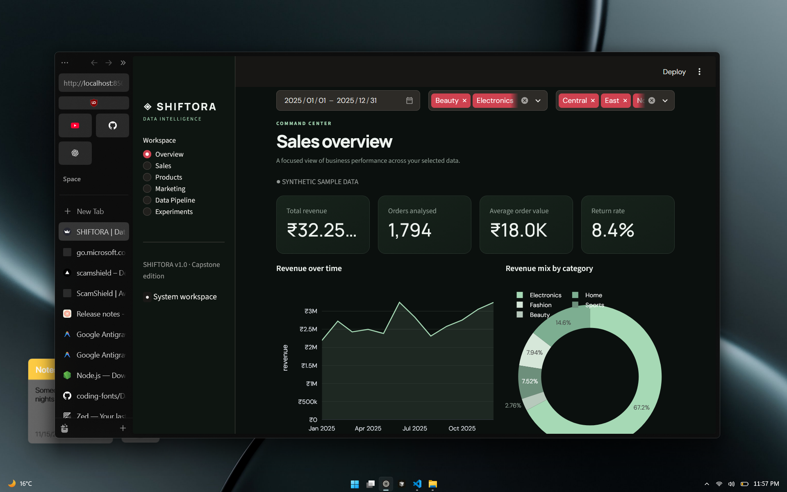
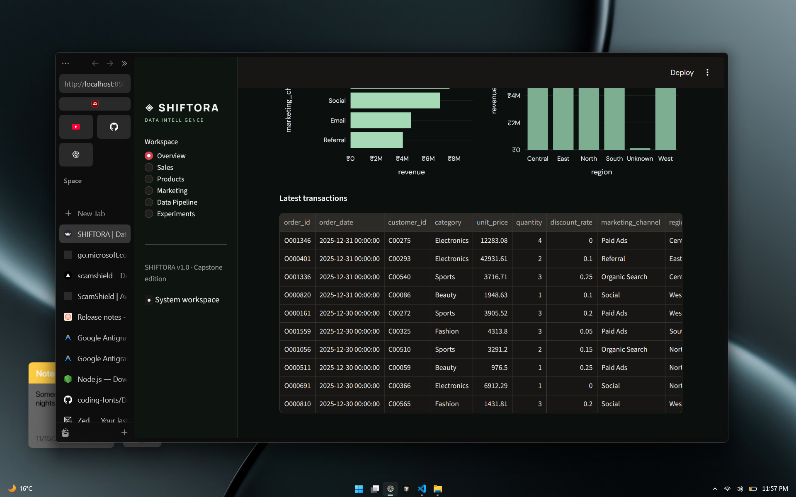

# ◈ SHIFTORA — Data Intelligence Platform

<p align="center">

**Raw data. Refined insights.**

An end-to-end data intelligence platform that transforms raw e-commerce transaction data into meaningful business insights through data processing, exploratory analytics, feature engineering, and machine learning.

</p>

<p align="center">


</p>

---

## Overview

SHIFTORA is a data intelligence platform built to demonstrate how raw e-commerce transaction data can be transformed into structured, meaningful, and machine-learning-ready information.

It combines data cleaning, exploratory data analysis, feature engineering, machine learning, and interactive business visualization in one workflow.

## Dashboard Preview

### Sales Overview



### Transaction Analytics



## Key Features

- **Data Cleaning:** Handle missing values, duplicates, and data inconsistencies.
- **Exploratory Data Analysis:** Discover patterns, trends, and relationships.
- **Sales Analytics:** Explore revenue, orders, categories, and regions.
- **Interactive Dashboard:** Explore insights through Streamlit.
- **Feature Engineering:** Prepare features for machine learning.
- **Machine Learning:** Demonstrate a Random Forest regression workflow.
- **Data Pipeline:** Transform raw data into structured outputs.
- **Experiment Analysis:** Present model evaluation metrics.

## Tech Stack

| Category | Technologies |
|---|---|
| Programming | Python |
| Data Processing | Pandas, NumPy |
| Visualization | Matplotlib, Plotly |
| Machine Learning | Scikit-learn |
| Dashboard | Streamlit |
| Model Storage | Joblib |

## Project Structure

```text
shiftora_capstone/
├── app.py
├── requirements.txt
├── README.md
├── data/
│   └── raw/
├── src/
│   ├── pipeline.py
│   └── eda.py
├── outputs/
│   ├── clean_orders.csv
│   ├── figures/
│   └── metrics/
├── models/
├── report/
└── screenshots/
    ├── dashboard-overview.png
    └── transaction-analytics.png
```

*Illustrative structure; adjust it if your actual folders differ.*

## Getting Started

### 1. Clone the repository

```bash
git clone https://github.com/rishabrahi/shiftora-capstone.git
cd shiftora-capstone
```

### 2. Install dependencies

```bash
python -m pip install -r requirements.txt
```

### 3. Run the data pipeline

```bash
python src/pipeline.py
```

### 4. Run exploratory data analysis

```bash
python src/eda.py
```

### 5. Launch the dashboard

```bash
streamlit run app.py
```

## Dashboard Modules

| Module | Description |
|---|---|
| Overview | Main dashboard |
| Sales | Revenue and transaction analytics |
| Products | Product performance |
| Marketing | Marketing channel analytics |
| Data Pipeline | Data processing and quality checks |
| Experiments | Model experiment metrics |

## Machine Learning

SHIFTORA demonstrates a Random Forest regression workflow involving data preparation, feature engineering, model training, and evaluation.

## Dataset Disclaimer

The included dataset is synthetic and intended for educational and demonstration purposes. It does not represent real customer transactions or confidential business information.

Model metrics and analytical findings are demonstration results, not real-world business performance.

## Future Improvements

- Integration with real-world datasets
- Advanced predictive analytics
- Automated data quality monitoring
- Additional machine learning models
- Cloud deployment and scalable pipelines

## Author

**Rishab Rahi**

BCA — Artificial Intelligence & Data Science

GitHub: [@rishabrahi](https://github.com/rishabrahi)

---

<p align="center">

**SHIFTORA**

*Raw data. Refined insights.*

</p>